  <a href="https://mayank-pillai.vercel.app"><b>Portfolio</b></a> ·
  <a href="https://www.linkedin.com/in/mayank-pillai-56798a30b/"><b>LinkedIn</b></a> ·
  <a href="mailto:mayankpillai99@gmail.com"><b>Email</b></a> ·
  <a href="https://leetcode.com/u/nkZEqqcSwd/"><b>LeetCode</b></a> ·
  <a href="https://mayank-pillai.vercel.app/Resume.pdf"><b>Resume</b></a>

## Hi, I'm Mayank 👋

## Featured work

  
  

  
  

  <b>Codebase Copilot</b> <a href="https://codebase-copilot-mu.vercel.app">live</a> · <a href="https://github.com/mayank-pillai-99/codebase-copilot">code</a> &nbsp;|&nbsp;
  <b>Hitbox</b> <a href="https://hitbox-6d3o.vercel.app">live</a> · <a href="https://github.com/mayank-pillai-99/Hitbox">code</a> &nbsp;|&nbsp;
  <b>Spatial Search</b> <a href="https://github.com/mayank-pillai-99/Intent-Driven-Spatial-Search-Engine">code</a> &nbsp;|&nbsp;
  <b>BookConnect</b> <a href="https://book-connect-frontend.vercel.app">live</a> · <a href="https://github.com/mayank-pillai-99/BookConnect-frontend">code</a>

## Tech stack

## GitHub stats

  
  

Self-hosted cards, redrawn every 6 hours by <a href="./.github/workflows/stats.yml">a workflow</a> from the GitHub API.
